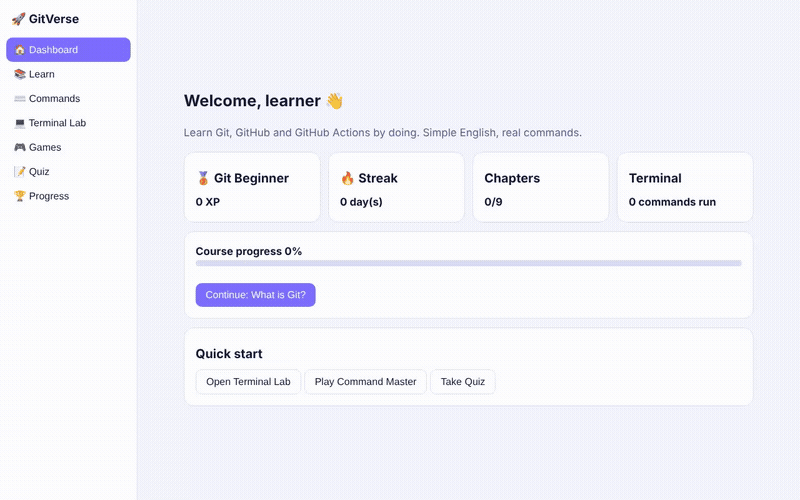
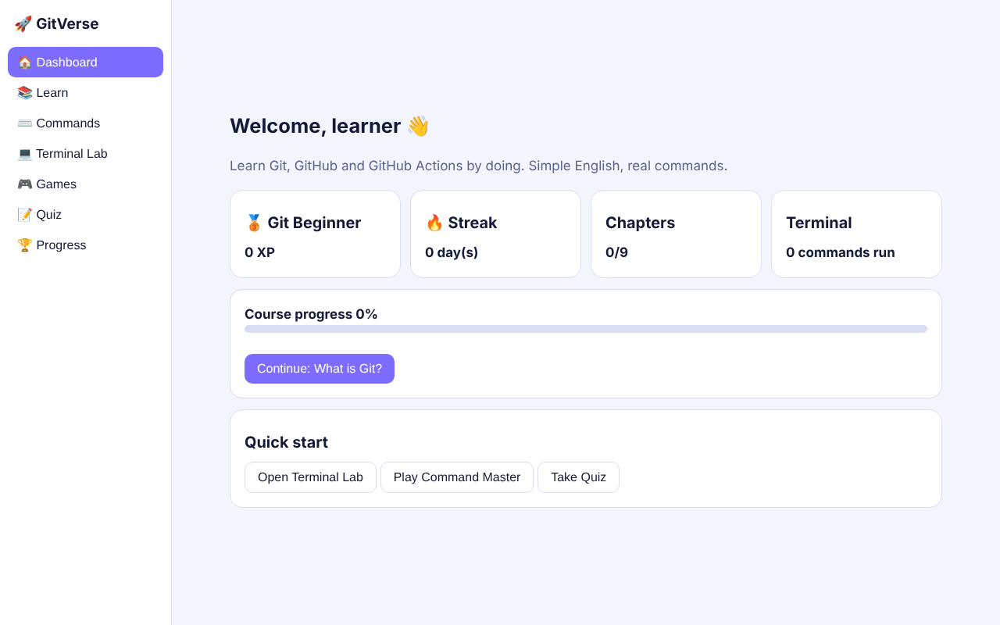
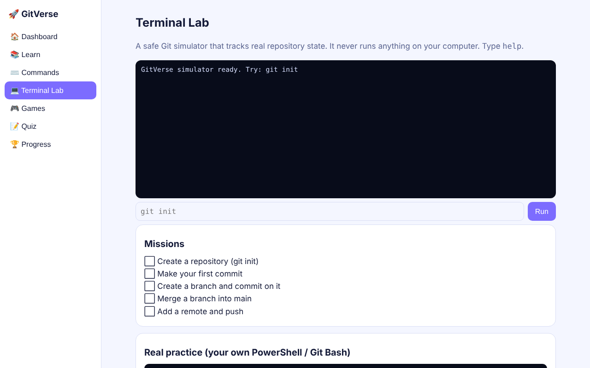
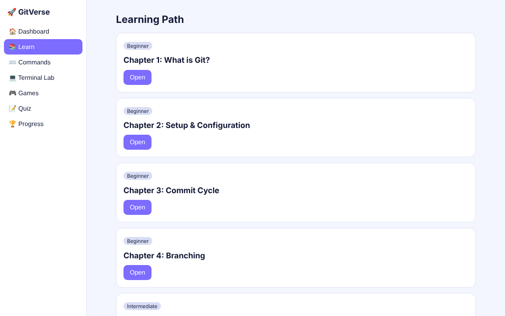
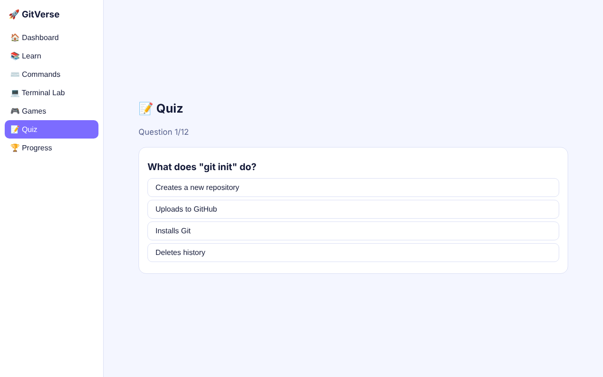
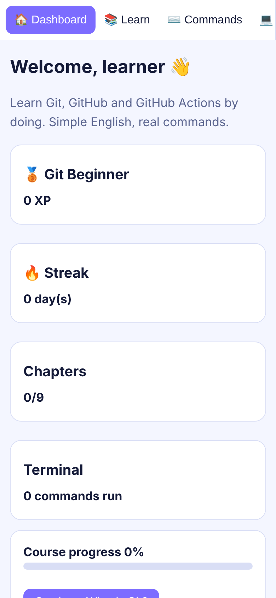
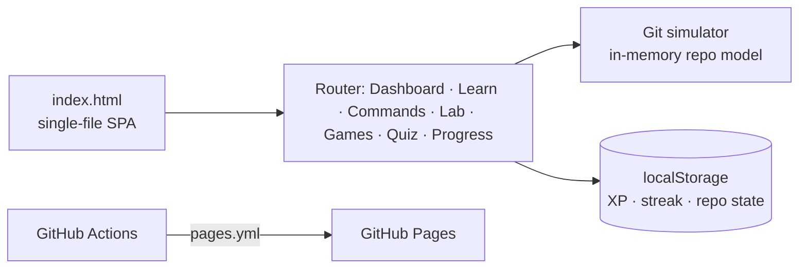

<h1 align="center">🚀 GitVerse Academy</h1>

<p align="center"><b>Learn Git, GitHub and GitHub Actions by doing: lessons, a safe Git simulator, games and quizzes in one offline web app.</b></p>

<p align="center">
  
  
  
</p>

<p align="center"></p>

## Why

Beginners usually learn Git by memorising commands they are scared to run. GitVerse lets them type real Git commands into a **simulator that tracks repository state** (commits, branches, merges, remotes) without touching their machine, then reinforces it with games and a quiz.

## Features

| | Feature | What it does |
|---|---|---|
| 🏠 | Dashboard | XP, daily streak, chapter progress and quick-start actions |
| 📚 | Learn | 9 chapters in plain English, from "what is Git" to Actions |
| ⌨️ | Commands | Searchable command reference |
| 💻 | Terminal Lab | Git simulator with guided missions (init → commit → branch → merge → push) |
| 🎮 | Games | Command-recall mini games |
| 📝 | Quiz | Multiple-choice checks with instant feedback |
| 🏆 | Progress | Saved locally in the browser (`localStorage`), no account needed |

## Screenshots

| Dashboard | Terminal Lab |
|---|---|
|  |  |
| **Learn** | **Quiz** |
|  |  |

<p align="center"></p>

## Run it

```bash
git clone https://github.com/nvaltryek-001/gitverse-academy
cd gitverse-academy
python -m http.server 8000   # or just open index.html
```

## Architecture



## Deployment

`.github/workflows/pages.yml` publishes the site to GitHub Pages on every push to `main`.

## Limitations

- The terminal is a teaching simulator; it supports a curated subset of Git commands.
- Progress is per-browser; clearing site data resets it.

<sub>Screenshots and demo were captured from the running app with Playwright.</sub>
